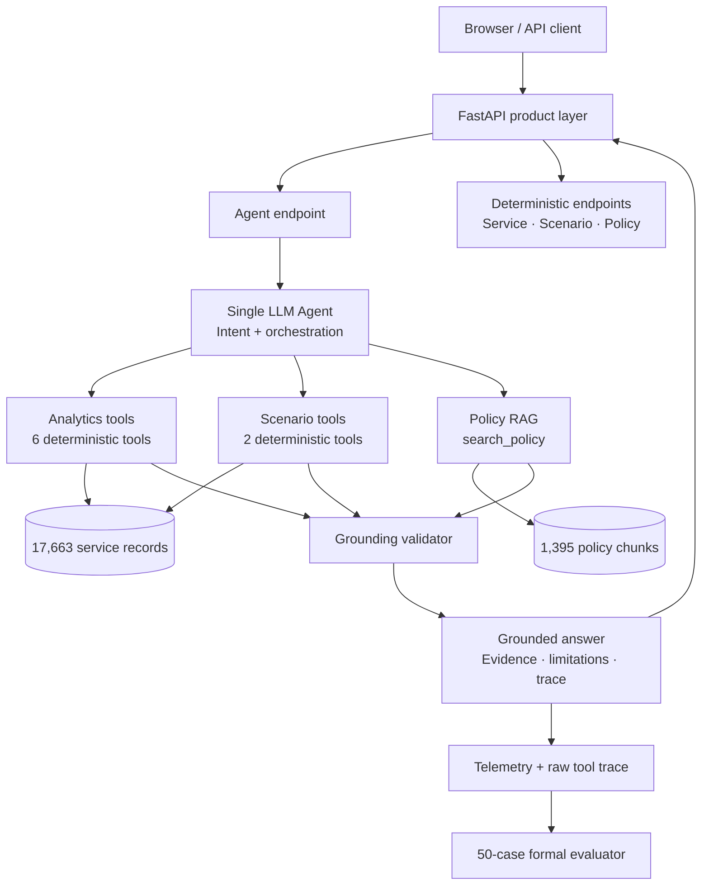

<div align="center">

# ACECQA Service Risk Copilot

**An evaluated, policy-grounded AI decision-support agent for prioritising Australian education and care services.**

[](README.md)
[](README.zh-CN.md)


</div>

> **Independent portfolio / academic project. Not affiliated with or endorsed by ACECQA.** The system is decision support only: its risk screen is not a legal finding, enforcement recommendation, or production regulatory model.

## Why this project exists

A policy or regulatory analyst may need to combine structured service data, spatial access indicators, quality outcomes, policy guidance, and “what-if” threshold analysis. A general-purpose chatbot can explain concepts, but it should not be trusted to silently calculate operational risk scores or invent evidence.

This project turns that workflow into an auditable AI system:

> **The LLM decides what evidence or simulation it needs; deterministic Python decides the numbers; curated retrieval supplies policy context; the runtime validates grounding; a formal benchmark checks system behaviour.**

The project evolved from a QBUS6860 spatial/data analysis assignment into a containerised B2B decision-support product with a web UI, HTTP API, deterministic analytics, policy RAG, scenario analysis, telemetry, and formal evaluation.

## At a glance

| Area | Implementation |
|---|---|
| Dataset | **17,663** cleaned Australian education and care service records |
| Agent | Single LLM agent for intent recognition and tool orchestration |
| Deterministic layer | Filtering, profiling, risk scoring, ranking, comparisons and scenarios |
| Policy grounding | Local BM25 retrieval over a versioned official ACECQA Guide snapshot |
| Tool surface | **9** typed tools with Pydantic contracts |
| Evaluation | **50/50 PASS** on the fixed v1.1 formal benchmark |
| Product surface | FastAPI + lightweight browser UI + OpenAPI docs |
| Deployment | Single-container Docker Compose deployment, verified end to end |

## Product demo flows

The browser demo supports four useful workflows without exposing internal implementation details to the user.

### 1. Prioritise services

> **Find the 5 highest-risk rural Centre-Based Care services in Queensland.**

The agent calls deterministic ranking logic instead of estimating results in-model.

### 2. Combine data with policy context

> **Find the 5 highest-risk rural Centre-Based Care services in Queensland and explain what the relevant regulatory authority should consider before deciding how to respond.**

The final response combines structured service evidence with policy chunks actually retrieved from the local official guidance corpus.

### 3. Run a scenario

> **What happens if poor transport changes from P75 to P80 while capacity stays at P25?**

The LLM does not calculate the new pool. Python recomputes thresholds and membership deterministically.

### 4. Respect evidence boundaries

> **Which services have the longest waiting lists?**

The system explains that the dataset has no waitlist measure instead of treating authorised capacity as demand.

## Architecture



The architecture intentionally separates **reasoning/orchestration** from **numerical authority**. See [Architecture](docs/ARCHITECTURE.md) and [Design Decisions](docs/DESIGN_DECISIONS.md).

## Nine product tools

| Capability | Tool |
|---|---|
| Service search | `search_services` |
| Service profile | `get_service_profile` |
| Individual risk score | `calculate_risk_score` |
| Priority ranking | `find_high_risk_services` |
| Transport comparison | `compare_transport_access` |
| Transport quartile outcomes | `analyse_transport_quartile_outcomes` |
| Baseline-relative scenario | `simulate_risk_thresholds` |
| Scenario A/B comparison | `compare_risk_scenarios` |
| Official guidance retrieval | `search_policy` |

Full contracts are documented in [Tool Schemas](docs/TOOL_SCHEMAS.md).

## Risk model and scenario rules

The current portfolio risk screen is scoped to **Centre-Based Care** and combines three signals:

1. poor public-transport access;
2. a Below Meeting NQS outcome; and
3. low authorised capacity.

The baseline assignment-derived thresholds are:

- national CBC transport P75: **5.329340 km**;
- national CBC capacity P25: **40 places**;
- national baseline triple-gap pool: **162 services**.

Scenario percentiles are always calculated from the **national validated Centre-Based Care risk sample**. State and urban/rural filters change the population being reported; they do not silently redefine P80 or P25 locally.

Example deterministic regression values:

| Scenario | Priority pool |
|---|---:|
| Baseline P75/P25 | **162** |
| P80/P25 | **149** |
| P70/P30 | **196** |
| P85/P20 | **111** |
| QLD Rural baseline | **21** |
| QLD Rural P80/P25 | **20** |

See [Scenario Analysis](docs/SCENARIO_ANALYSIS.md).

## Policy grounding

`search_policy()` performs local BM25 retrieval over a versioned snapshot of the **Guide to the National Quality Framework**. The current corpus contains **1,395 chunks**.

Policy evidence is kept separate from structured service evidence. Final policy citations must resolve to chunk IDs that were actually returned in the tool trace. The Guide is treated as official guidance, not legal advice; the National Law and Regulations take precedence.

See [Policy Corpus](docs/POLICY_CORPUS.md).

## Formal evaluation

The fixed benchmark is stored in [`evals/m5_benchmark.json`](evals/m5_benchmark.json). The retained final run is auditable under [`evals/m5_results/20260819_221712`](evals/m5_results/20260819_221712).

| Metric | Result |
|---|---:|
| Task Success Rate | **100.0%** |
| Tool Selection Accuracy | **100.0%** |
| Tool Parameter Accuracy | **100.0%** |
| Deterministic Output Accuracy | **100.0%** |
| Numerical Accuracy | **100.0%** |
| Evidence Grounding Accuracy | **100.0%** |
| Policy Grounding Rate | **100.0%** |
| Boundary Handling Rate | **100.0%** |
| Average tokens/query | 9,290 |
| Average latency/query | 6.89 s |
| Average tool calls/query | 1.02 |

Category coverage:

- data retrieval — 8/8;
- risk analysis — 8/8;
- comparison — 6/6;
- policy RAG — 8/8;
- scenario analysis — 8/8;
- reliability / boundary handling — 12/12.

These results demonstrate behaviour on a **fixed 50-query benchmark snapshot**. They are not evidence of regulatory validity, real-world policy optimality, or safe autonomous decision-making. See [Evaluation](docs/EVALUATION.md).

## Quick start

### Option A — Docker Compose

Requirements: Docker Desktop / Docker Engine with Compose.

```bash
cp .env.example .env
# Add your OPENAI_API_KEY to .env for live Copilot requests.

docker compose up --build
```

Open:

- Product UI: `http://localhost:8000`
- Swagger / OpenAPI: `http://localhost:8000/docs`
- Health check: `http://localhost:8000/health`

Service lookup, scenario analysis, policy retrieval, health and system-info endpoints are deterministic. Only `/api/chat` requires an OpenAI API key.

### Option B — Local Python

Python 3.10+ is supported; the Docker image uses Python 3.12.

```bash
python -m venv .venv
source .venv/bin/activate
pip install -e ".[dev]"

export OPENAI_API_KEY="your-key"
python run_api.py
```

For detailed deployment notes, see [Deployment](docs/DEPLOYMENT.md).

## API surface

| Method | Endpoint | Purpose |
|---|---|---|
| `GET` | `/health` | Process health |
| `GET` | `/api/system/info` | Dataset, corpus, tool and evaluation snapshot |
| `POST` | `/api/chat` | Full agent orchestration |
| `GET` | `/api/services/{service_id}` | Deterministic service profile |
| `POST` | `/api/scenario` | Deterministic threshold sensitivity analysis |
| `POST` | `/api/policy/search` | Deterministic local BM25 retrieval |

Example:

```bash
curl -X POST http://localhost:8000/api/chat \
  -H 'Content-Type: application/json' \
  -d '{
    "message": "Find the 5 highest-risk rural Centre-Based Care services in Queensland and explain what the relevant regulatory authority should consider before deciding how to respond."
  }'
```

## Reliability boundaries

The system is explicitly designed and evaluated **not** to infer that:

- authorised capacity equals demand, enrolment, utilisation, vacancies or waiting lists;
- association implies causation;
- Working Towards NQS automatically means unsafe care;
- a triple-gap score establishes legal non-compliance;
- a smaller scenario pool proves a better policy;
- subgroup filters can silently redefine national percentile thresholds;
- ACECQA itself is the state/territory enforcement authority.

These are product requirements, not just disclaimer text: several are encoded as adversarial benchmark cases.

## Repository structure

```text
acecqa-risk-agent/
├── data/
│   ├── education_services_cleaned.csv
│   └── policy/                  # Versioned local policy corpus
├── evals/
│   ├── m5_benchmark.json        # Formal 50-query benchmark
│   └── m5_results/              # Retained final audited run
├── frontend/                    # Lightweight product UI
├── src/acecqa_agent/
│   ├── agent/                   # Agent runtime, prompt and tool adapter
│   ├── api/                     # FastAPI product surface
│   ├── evals/                   # Formal evaluator
│   ├── rag/                     # Local BM25 policy retrieval
│   └── tools/                   # Deterministic analytics/scenario tools
├── tests/                       # Regression suite
├── docs/                        # Canonical engineering documentation
│   └── history/                 # Milestone / merge history
├── Dockerfile
├── docker-compose.yml
├── run_api.py
├── run_m5_eval.py
└── pyproject.toml
```

## Verification

Run the zero-token regression and integrity suite:

```bash
pytest -q
python scripts/check_m5_benchmark.py
python scripts/check_policy_corpus.py
python scripts/check_m6_product.py
```

Current frozen M6 baseline:

```text
43 passed
M5 benchmark integrity: PASS (50 cases)
Corpus integrity: PASS
M6 product integrity: PASS
```

The same checks run in GitHub Actions.

## Key design decisions

- **Deterministic analytics first.** Filtering, ranking, aggregation, scoring and scenario arithmetic live in Python tools, not model prose.
- **One agent, not a multi-agent demo.** The product only adds complexity where a measured workflow requires it.
- **RAG is a tool, not the whole product.** Policy retrieval complements structured analytics instead of replacing them.
- **Grounding is enforced at runtime.** Data and policy evidence must resolve to the tools/chunks actually used.
- **Evaluation is a product feature.** Raw reports and machine-readable metrics make regressions diagnosable and re-scoreable.
- **One-container delivery.** FastAPI serves both API and frontend for a reproducible portfolio deployment.

More detail: [Design Decisions](docs/DESIGN_DECISIONS.md).

## Limitations

- The risk model was derived for this academic/portfolio dataset and is not a production regulatory model.
- The v1 risk screen is scoped to Centre-Based Care.
- Policy retrieval uses a versioned Guide snapshot and can become stale until the corpus is refreshed.
- Authorised capacity does not measure demand, enrolment, utilisation, vacancies or waiting lists.
- BM25 is intentionally simple and auditable; a larger corpus may benefit from semantic reranking.
- The frontend is a portfolio demo, not a multi-user production application.
- There is no authentication, persistence, RBAC, production observability stack or managed secrets layer.

## Portfolio framing

**AI Product Management:** problem framing → analyst workflow → task-oriented agent → scenario exploration → trust boundaries → measurable evaluation → deployed demo.

**Forward-Deployed / AI Engineering:** data contracts → deterministic tools → LLM orchestration → grounded RAG → scenario engine → tracing/evals → FastAPI → containerised delivery.

## Documentation

Start with [docs/README.md](docs/README.md) for the documentation map.

---

<div align="center">

[](README.zh-CN.md)

</div>
