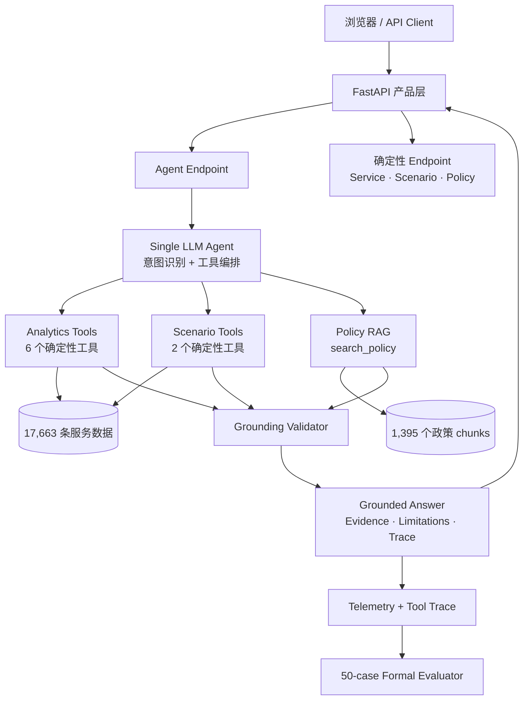

<div align="center">

# ACECQA Service Risk Copilot

**一个经过正式评测、具备政策依据与可审计工具调用的澳大利亚教育与照护服务风险决策支持 Agent。**

[](README.md)
[](README.zh-CN.md)


</div>

> **独立的作品集，与 ACECQA 无隶属或官方背书关系。** 本系统仅用于决策支持；风险评分不代表法律违规认定、执法建议，也不是生产级监管模型。

## 项目要解决什么问题

监管或政策分析人员往往需要同时处理结构化服务数据、空间交通可达性、质量评级、官方政策说明，以及“如果阈值改变会怎样”的情景分析。通用聊天机器人可以解释概念，但不应该被允许在没有可审计计算过程的情况下直接给出关键风险数字或编造证据。

因此，这个项目采用了一个明确原则：

> **LLM 决定需要什么证据或模拟；确定性的 Python 负责计算数字；经过整理的检索层提供政策上下文；运行时验证 Grounding；正式 Benchmark 检查系统行为。**

项目最初来自 QBUS6860 的空间 / 数据分析作业，随后逐步扩展为一个具备 Web UI、HTTP API、确定性分析工具、Policy RAG、Scenario Analysis、Telemetry、正式评测和 Docker 部署的 B2B AI 决策支持产品。

## 项目概览

| 维度 | 当前实现 |
|---|---|
| 数据 | **17,663** 条清洗后的澳大利亚教育与照护服务记录 |
| Agent | 单一 LLM Agent，负责意图识别与工具编排 |
| 确定性计算层 | 筛选、服务 Profile、风险评分、排序、比较与场景模拟 |
| 政策 Grounding | 对版本化 ACECQA Guide 快照进行本地 BM25 检索 |
| Tool 数量 | **9** 个具备 Pydantic 输入输出契约的工具 |
| 正式评测 | 固定 v1.1 Benchmark **50/50 PASS** |
| 产品形态 | FastAPI + 轻量浏览器 UI + OpenAPI 文档 |
| 部署 | 单容器 Docker Compose，已完成端到端验证 |

## 四个核心 Demo 场景

### 1. 服务风险优先级

> **Find the 5 highest-risk rural Centre-Based Care services in Queensland.**

Agent 不会自己猜测答案，而是调用确定性的风险排序工具。

### 2. 数据 + 政策联合分析

> **Find the 5 highest-risk rural Centre-Based Care services in Queensland and explain what the relevant regulatory authority should consider before deciding how to respond.**

最终答案会同时包含结构化服务数据证据和实际从官方政策语料中检索到的 Policy chunks。

### 3. Scenario Analysis

> **What happens if poor transport changes from P75 to P80 while capacity stays at P25?**

LLM 不负责计算结果；Python 会重新确定阈值并计算优先级池的变化。

### 4. 可靠性边界

> **Which services have the longest waiting lists?**

当前数据集没有 waiting-list 指标，因此系统会明确说明无法回答，而不是把 authorised capacity 错当作需求或候补名单数据。

## 系统架构



核心设计是把 **LLM 的推理 / 编排能力** 与 **数值计算权** 分开。详细设计见 [Architecture](docs/ARCHITECTURE.md) 和 [Design Decisions](docs/DESIGN_DECISIONS.md)。

## 9 个 Product Tools

| 能力 | Tool |
|---|---|
| 服务搜索 | `search_services` |
| 服务 Profile | `get_service_profile` |
| 单服务风险评分 | `calculate_risk_score` |
| 高风险服务排序 | `find_high_risk_services` |
| 交通可达性比较 | `compare_transport_access` |
| 交通四分位结果分析 | `analyse_transport_quartile_outcomes` |
| 相对 Baseline 的 Scenario | `simulate_risk_thresholds` |
| Scenario A/B 比较 | `compare_risk_scenarios` |
| 官方政策检索 | `search_policy` |

完整 Schema 见 [Tool Schemas](docs/TOOL_SCHEMAS.md)。

## 风险模型与 Scenario 规则

当前作品集中的 Risk Screen 仅针对 **Centre-Based Care**，由三个信号组成：

1. 较差的公共交通可达性；
2. Below Meeting NQS 的质量结果；
3. 较低的 authorised capacity。

Baseline 阈值来自原始分析模型：

- 全国 CBC transport P75：**5.329340 km**；
- 全国 CBC capacity P25：**40 places**；
- 全国 baseline triple-gap pool：**162 个服务**。

Scenario 的 percentile 始终从 **national validated Centre-Based Care risk sample** 计算。State 和 Urban/Rural filter 只改变被报告的群体，不能在 subgroup 内偷偷重新定义 P80 或 P25。

关键回归值：

| Scenario | Priority pool |
|---|---:|
| Baseline P75/P25 | **162** |
| P80/P25 | **149** |
| P70/P30 | **196** |
| P85/P20 | **111** |
| QLD Rural baseline | **21** |
| QLD Rural P80/P25 | **20** |

详细说明见 [Scenario Analysis](docs/SCENARIO_ANALYSIS.md)。

## Policy Grounding

`search_policy()` 对版本化的 **Guide to the National Quality Framework** 快照执行本地 BM25 检索。当前政策语料包含 **1,395 个 chunks**。

政策证据与结构化服务数据证据被明确分开；最终 Policy citation 必须能解析到真实出现在 tool trace 中的 chunk ID。Guide 被视作官方 guidance，而不是法律意见；National Law 和 Regulations 具有更高优先级。

详细说明见 [Policy Corpus](docs/POLICY_CORPUS.md)。

## 正式评测

固定 Benchmark 位于 [`evals/m5_benchmark.json`](evals/m5_benchmark.json)，最终保留的完整评测结果位于 [`evals/m5_results/20260819_221712`](evals/m5_results/20260819_221712)。

| 指标 | 结果 |
|---|---:|
| Task Success Rate | **100.0%** |
| Tool Selection Accuracy | **100.0%** |
| Tool Parameter Accuracy | **100.0%** |
| Deterministic Output Accuracy | **100.0%** |
| Numerical Accuracy | **100.0%** |
| Evidence Grounding Accuracy | **100.0%** |
| Policy Grounding Rate | **100.0%** |
| Boundary Handling Rate | **100.0%** |
| 平均 Tokens / Query | 9,290 |
| 平均 Latency / Query | 6.89 s |
| 平均 Tool Calls / Query | 1.02 |

分类结果：

- Data Retrieval — 8/8；
- Risk Analysis — 8/8；
- Comparison — 6/6；
- Policy RAG — 8/8；
- Scenario Analysis — 8/8；
- Reliability / Boundary Handling — 12/12。

这些成绩只表示系统在一个**固定的 50-query benchmark snapshot** 上通过了设定的测试，并不证明真实监管有效性、政策最优性或可安全进行自主监管决策。详细说明见 [Evaluation](docs/EVALUATION.md)。

## 快速运行

### 方式 A — Docker Compose

需要 Docker Desktop / Docker Engine + Compose。

```bash
cp .env.example .env
# 如果需要 Live Copilot，在 .env 中加入 OPENAI_API_KEY。

docker compose up --build
```

打开：

- 产品页面：`http://localhost:8000`
- Swagger / OpenAPI：`http://localhost:8000/docs`
- Health Check：`http://localhost:8000/health`

Service Lookup、Scenario、Policy Retrieval、Health 和 System Info 都是确定性接口；只有 `/api/chat` 需要 OpenAI API Key。

### 方式 B — 本地 Python

支持 Python 3.10+；Docker image 使用 Python 3.12。

```bash
python -m venv .venv
source .venv/bin/activate
pip install -e ".[dev]"

export OPENAI_API_KEY="your-key"
python run_api.py
```

更详细的部署说明见 [Deployment](docs/DEPLOYMENT.md)。

## API

| Method | Endpoint | 用途 |
|---|---|---|
| `GET` | `/health` | 服务健康检查 |
| `GET` | `/api/system/info` | 数据、政策 corpus、tools 和评测快照 |
| `POST` | `/api/chat` | 完整 Agent 编排 |
| `GET` | `/api/services/{service_id}` | 确定性 Service Profile |
| `POST` | `/api/scenario` | 确定性阈值敏感性分析 |
| `POST` | `/api/policy/search` | 本地 BM25 政策检索 |

示例：

```bash
curl -X POST http://localhost:8000/api/chat \
  -H 'Content-Type: application/json' \
  -d '{
    "message": "Find the 5 highest-risk rural Centre-Based Care services in Queensland and explain what the relevant regulatory authority should consider before deciding how to respond."
  }'
```

## Reliability Boundaries

系统在设计和正式评测中明确要求**不能**得出以下错误推断：

- authorised capacity = demand / enrolment / utilisation / vacancies / waiting lists；
- association = causation；
- Working Towards NQS = 自动代表 unsafe care；
- triple-gap score = 法律违规认定；
- 更小的 scenario priority pool = 更优政策；
- subgroup filter 可以偷偷重新定义 national percentile threshold；
- ACECQA 本身就是州 / 领地的执法监管机构。

这些不是只写在 README 里的免责声明，其中多项都被设计成正式 Benchmark 的 adversarial cases。

## 仓库结构

```text
acecqa-risk-agent/
├── data/
│   ├── education_services_cleaned.csv
│   └── policy/                  # 版本化本地政策语料
├── evals/
│   ├── m5_benchmark.json        # 50-query 正式 Benchmark
│   └── m5_results/              # 保留最终完整评测结果
├── frontend/                    # 轻量产品 UI
├── src/acecqa_agent/
│   ├── agent/                   # Agent runtime / prompt / tool adapter
│   ├── api/                     # FastAPI 产品层
│   ├── evals/                   # Formal evaluator
│   ├── rag/                     # 本地 BM25 Policy RAG
│   └── tools/                   # 确定性 analytics / scenario tools
├── tests/                       # Regression tests
├── docs/                        # 正式工程文档
│   └── history/                 # Milestone / merge 历史
├── Dockerfile
├── docker-compose.yml
├── run_api.py
├── run_m5_eval.py
└── pyproject.toml
```

## 验证

执行以下零 token 回归和 integrity checks：

```bash
pytest -q
python scripts/check_m5_benchmark.py
python scripts/check_policy_corpus.py
python scripts/check_m6_product.py
```

当前冻结的 M6 baseline：

```text
43 passed
M5 benchmark integrity: PASS (50 cases)
Corpus integrity: PASS
M6 product integrity: PASS
```

GitHub Actions 会运行同一套检查。

## 关键设计决策

- **Deterministic analytics first**：筛选、排序、聚合、评分和 Scenario 数值计算由 Python 工具负责，而不是 LLM prose。
- **Single Agent 而不是为了展示而 Multi-Agent**：只有当实际 workflow 需要时才增加系统复杂度。
- **RAG 是工具，不是整个产品**：Policy Retrieval 用于补充结构化数据分析，而不是把项目做成普通文档问答机器人。
- **Grounding 在 runtime 强制执行**：Data / Policy evidence 必须能解析回真实调用的 tools 和 chunks。
- **Evaluation 是系统组成部分**：保留 raw reports 和 machine-readable metrics，可诊断失败，也可在不重新调用 API 的情况下重新评分。
- **单容器交付**：FastAPI 同时服务 API 和 frontend，便于作品集快速复现。

详细说明见 [Design Decisions](docs/DESIGN_DECISIONS.md)。

## 当前限制

- 风险模型来自学术 / 作品集数据，不是生产级监管模型；
- v1 Risk Screen 只覆盖 Centre-Based Care；
- Policy Retrieval 使用版本化 Guide 快照，需要主动刷新语料才能保持时效；
- authorised capacity 不能代表 demand、enrolment、utilisation、vacancies 或 waiting lists；
- BM25 的选择是为了简单、可审计；更大语料下可考虑 semantic reranking；
- 前端目标是 Portfolio Demo，而不是多用户生产系统；
- 当前没有 Authentication、Persistence、RBAC、生产级 Observability 和 Managed Secrets。

## 求职角度如何理解这个项目

**AI Product Management：** 问题定义 → 分析师 workflow → task-oriented Agent → Scenario exploration → trust boundaries → measurable evaluation → deployed demo。

**Forward-Deployed / AI Engineering：** data contracts → deterministic tools → LLM orchestration → grounded RAG → scenario engine → tracing/evals → FastAPI → containerised delivery。

## 文档

从 [docs/README.md](docs/README.md) 开始可以快速浏览整个工程文档结构。

---

<div align="center">

[](README.md)

</div>
