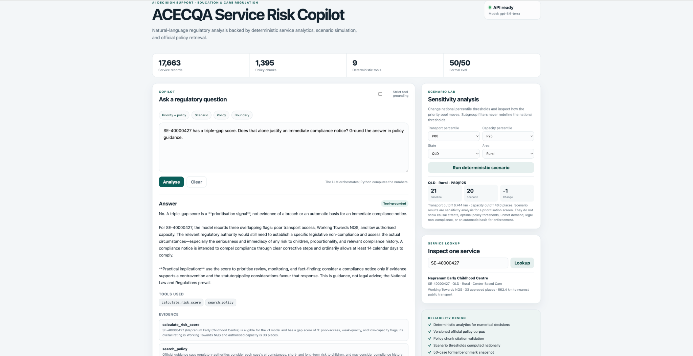
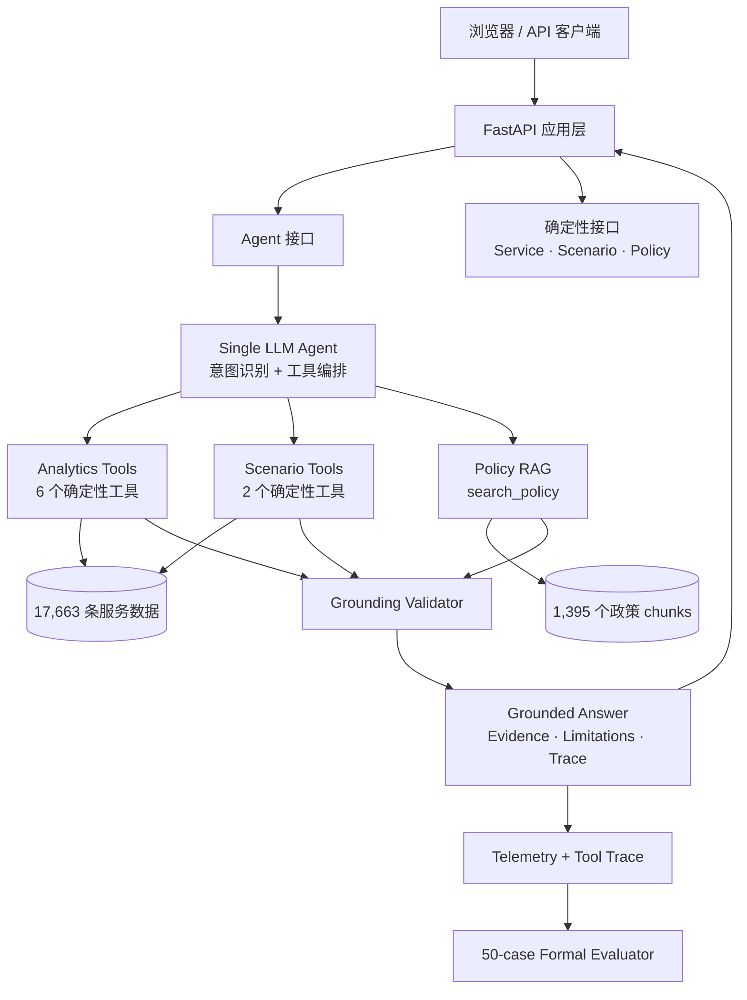

<div align="center">

# ACECQA Service Risk Copilot

**面向澳大利亚教育与照护服务的 AI 决策支持系统，结合确定性分析、官方政策检索和可审计的工具调用。**

[](README.md)
[](README.zh-CN.md)


</div>

> **本项目为独立完成的作品集/学术项目，与 ACECQA 无隶属关系，也未获得其官方背书。** 系统仅用于决策支持；风险评分不构成法律违规认定或执法建议，也不是生产级监管模型。

## 产品界面

<p align="center">
  
</p>

<p align="center"><sub>已完成 Docker 端到端验证：界面同时展示基于工具调用的风险与政策联合分析、确定性情景模拟和结构化服务查询。</sub></p>

> **LLM 负责理解与编排，Python 负责计算，政策检索提供依据，评测体系验证系统行为。**

## 背景与目标

监管或政策分析人员往往需要同时查看结构化服务数据、交通可达性、质量评级和官方政策说明，还需要回答“如果风险阈值改变，优先级结果会怎样变化”这类问题。通用聊天模型可以解释概念，但关键风险数字不应由模型直接估算，政策依据也不应凭空生成。

因此，系统把不同职责拆开：LLM 负责理解用户问题并选择合适的工具；筛选、排序、风险评分和情景计算由 Python 工具按固定逻辑完成；政策内容来自本地版本化语料；运行时还会检查最终回答是否真正引用了本次调用得到的数据和政策证据。

## 项目概览

| 维度 | 实现 |
|---|---|
| 数据 | **17,663** 条清洗后的澳大利亚教育与照护服务记录 |
| Agent | 单一 LLM Agent，负责意图识别和工具编排 |
| 确定性分析 | 服务筛选、详情查询、风险评分、排序、比较和情景模拟 |
| 政策检索 | 对版本化的 ACECQA 官方 Guide 快照进行本地 BM25 检索 |
| 工具 | **9** 个带 Pydantic 输入输出约束的工具 |
| 正式评测 | 固定的 v1.1 正式测试集 **50/50 PASS** |
| 产品形态 | FastAPI + 轻量 Web UI + OpenAPI 文档 |
| 部署 | 单容器 Docker Compose，已完成端到端验证 |

## 主要使用场景

### 1. 筛选高风险服务

> **Find the 5 highest-risk rural Centre-Based Care services in Queensland.**

这类结果由确定性的风险排序工具计算，LLM 负责理解请求并选择工具，而不是自行估算排名。

### 2. 将服务数据与政策依据结合

> **Find the 5 highest-risk rural Centre-Based Care services in Queensland and explain what the relevant regulatory authority should consider before deciding how to respond.**

最终回答会同时给出结构化服务数据和本次实际检索到的官方政策片段，并保留相应的证据来源。

### 3. 情景分析

> **What happens if poor transport changes from P75 to P80 while capacity stays at P25?**

LLM 不直接计算新结果。Python 会重新计算阈值以及哪些服务进入优先级池，并返回变化结果。

### 4. 数据不足时明确拒绝推断

> **Which services have the longest waiting lists?**

当前数据集没有候补名单指标，因此系统会明确说明数据不足，不会用核定容量代替需求或候补名单数据。

## 系统架构



架构上刻意把 **LLM 的理解 / 编排能力** 和 **数值计算权** 分开。更多细节见 [Architecture](docs/ARCHITECTURE.md) 和 [Design Decisions](docs/DESIGN_DECISIONS.md)。

## 9 个工具

| 能力 | Tool |
|---|---|
| 服务搜索 | `search_services` |
| 服务详情 | `get_service_profile` |
| 单服务风险评分 | `calculate_risk_score` |
| 高风险服务排序 | `find_high_risk_services` |
| 交通可达性比较 | `compare_transport_access` |
| 交通四分位结果分析 | `analyse_transport_quartile_outcomes` |
| 基线对比情景模拟 | `simulate_risk_thresholds` |
| 情景 A/B 对比 | `compare_risk_scenarios` |
| 官方政策检索 | `search_policy` |

完整输入输出定义见 [Tool Schemas](docs/TOOL_SCHEMAS.md)。

## 风险模型与情景分析

当前风险筛选模型仅针对 **Centre-Based Care**，由三个信号组成：

1. 公共交通可达性较差；
2. NQS 评级低于 Meeting NQS；
3. 核定容量较低。

基准阈值为：

- 全国 CBC 交通距离 P75：**5.329340 km**；
- 全国 CBC 核定容量 P25：**40 个名额**；
- 全国基准 triple-gap 服务数：**162**。

情景分析中的百分位阈值始终基于 **全国已验证的 Centre-Based Care 风险样本** 计算。州别和城乡筛选只用于限定结果范围，不会在某个子群体内重新计算 P80 或 P25。

关键回归结果：

| Scenario | Priority pool |
|---|---:|
| Baseline P75/P25 | **162** |
| P80/P25 | **149** |
| P70/P30 | **196** |
| P85/P20 | **111** |
| QLD Rural baseline | **21** |
| QLD Rural P80/P25 | **20** |

详细说明见 [Scenario Analysis](docs/SCENARIO_ANALYSIS.md)。

## 政策检索与引用

`search_policy()` 对版本化的 **Guide to the National Quality Framework** 快照执行本地 BM25 检索。当前语料包含 **1,395 个政策片段**。

政策证据与结构化服务数据分开记录。最终政策引用必须对应本次工具调用中实际返回的 chunk ID，避免模型自行编造来源。Guide 属于官方指导材料，不构成法律意见；如有冲突，以 National Law 和 Regulations 为准。

详细说明见 [Policy Corpus](docs/POLICY_CORPUS.md)。

## 正式评测

固定测试集位于 [`evals/m5_benchmark.json`](evals/m5_benchmark.json)，保留的最终完整评测结果位于 [`evals/m5_results/20260819_221712`](evals/m5_results/20260819_221712)。

| 指标 | 结果 |
|---|---:|
| Task Success Rate | **100.0%** |
| Tool Selection Accuracy | **100.0%** |
| Tool Parameter Accuracy | **100.0%** |
| Deterministic Output Accuracy | **100.0%** |
| Numerical Accuracy | **100.0%** |
| Evidence Grounding Accuracy | **100.0%** |
| Policy Grounding Rate | **100.0%** |
| Boundary Handling Rate | **100.0%** |
| 平均 Token 数 / 问题 | 9,290 |
| 平均延迟 / 问题 | 6.89 s |
| 平均工具调用次数 / 问题 | 1.02 |

分类结果：

- 数据检索 — 8/8；
- 风险分析 — 8/8；
- 对比分析 — 6/6；
- 政策检索 — 8/8；
- 情景分析 — 8/8；
- 可靠性与边界处理 — 12/12。

这些结果只表示系统在一个**固定的 50 条测试集**上通过了既定检查，并不代表真实监管场景中的准确率为 100%，也不证明政策阈值最优或系统可以自主做出监管决定。详细说明见 [Evaluation](docs/EVALUATION.md)。

## 快速开始

### 方式 A — Docker Compose

需要 Docker Desktop / Docker Engine 和 Compose。

```bash
cp .env.example .env
# 如需使用 Agent 问答，请在 .env 中配置 OPENAI_API_KEY。

docker compose up --build
```

打开：

- 产品页面：`http://localhost:8000`
- API 文档：`http://localhost:8000/docs`
- 健康检查：`http://localhost:8000/health`

服务查询、情景分析、政策检索、健康检查和系统信息接口均为确定性接口；只有 `/api/chat` 需要 OpenAI API Key。

### 方式 B — 本地 Python

支持 Python 3.10+；Docker 镜像使用 Python 3.12。

```bash
python -m venv .venv
source .venv/bin/activate
pip install -e ".[dev]"

export OPENAI_API_KEY="your-key"
python run_api.py
```

更详细的部署说明见 [Deployment](docs/DEPLOYMENT.md)。

## API 接口

| Method | Endpoint | 用途 |
|---|---|---|
| `GET` | `/health` | 服务健康检查 |
| `GET` | `/api/system/info` | 数据、政策语料、工具和评测快照 |
| `POST` | `/api/chat` | 完整 Agent 编排 |
| `GET` | `/api/services/{service_id}` | 确定性服务详情 |
| `POST` | `/api/scenario` | 确定性阈值敏感性分析 |
| `POST` | `/api/policy/search` | 本地 BM25 政策检索 |

示例：

```bash
curl -X POST http://localhost:8000/api/chat \
  -H 'Content-Type: application/json' \
  -d '{
    "message": "Find the 5 highest-risk rural Centre-Based Care services in Queensland and explain what the relevant regulatory authority should consider before deciding how to respond."
  }'
```

## 可靠性边界

系统在设计和正式评测中明确禁止以下推断：

- 把 authorised capacity 当作需求、实际入园人数、利用率、空缺或候补名单；
- 把统计相关性解释为因果关系；
- 认为 Working Towards NQS 自动代表服务不安全；
- 把 triple-gap score 当作法律违规认定；
- 认为更小的情景优先级池一定代表更好的政策；
- 用州别或城乡筛选结果重新定义全国百分位阈值；
- 把 ACECQA 本身视为各州 / 领地的执法监管机构。

这些边界不仅写在 README 中，其中多项都被纳入正式测试集的对抗性案例。

## 仓库结构

```text
acecqa-risk-agent/
├── data/
│   ├── education_services_cleaned.csv
│   └── policy/                  # 版本化本地政策语料
├── evals/
│   ├── m5_benchmark.json        # 50 条正式测试集
│   └── m5_results/              # 保留最终完整评测结果
├── frontend/                    # 轻量 Web UI
├── src/acecqa_agent/
│   ├── agent/                   # Agent runtime / prompt / tool adapter
│   ├── api/                     # FastAPI 应用层
│   ├── evals/                   # Formal evaluator
│   ├── rag/                     # 本地 BM25 政策检索
│   └── tools/                   # 确定性分析 / 情景工具
├── tests/                       # 回归测试
├── docs/                        # 工程文档
│   └── history/                 # Milestone / merge 历史记录
├── Dockerfile
├── docker-compose.yml
├── run_api.py
├── run_m5_eval.py
└── pyproject.toml
```

## 本地验证

以下检查均无需调用模型 API：

```bash
pytest -q
python scripts/check_m5_benchmark.py
python scripts/check_policy_corpus.py
python scripts/check_m6_product.py
```

当前稳定版本的检查结果：

```text
43 passed
M5 benchmark integrity: PASS (50 cases)
Corpus integrity: PASS
M6 product integrity: PASS
```

GitHub Actions 会运行同一套检查。

## 设计取舍

- **数值计算交给确定性工具**：筛选、排序、聚合、评分和情景计算由 Python 执行，不让 LLM 在文本回答中自行计算关键数字。
- **保持单 Agent 架构**：当前工作流不需要 Multi-Agent，因此不为展示效果额外增加复杂度。
- **RAG 只是其中一个能力层**：政策检索用于补充结构化数据分析，而不是把整个产品做成文档问答。
- **运行时强制 Grounding**：数据和政策证据必须能够追溯到本次实际调用的工具和政策片段。
- **评测可以重复执行和复核**：保留 raw reports 和机器可读指标，既能定位失败，也能在不重新调用模型的情况下重新评分。
- **单容器交付**：FastAPI 同时提供 API 和前端页面，方便本地复现和演示。

详细说明见 [Design Decisions](docs/DESIGN_DECISIONS.md)。

## 已知限制

- 风险模型基于本项目的数据和分析假设，不是生产级监管模型；
- v1 风险筛选仅覆盖 Centre-Based Care；
- 政策检索依赖版本化 Guide 快照，需要主动更新语料才能反映后续政策变化；
- authorised capacity 不能代表需求、实际入园人数、利用率、空缺或候补名单；
- BM25 便于审计和复现，但如果未来扩展到更大的政策语料，可进一步加入语义检索或 reranking；
- 当前前端用于本地演示，不是多用户生产系统；
- 尚未实现用户认证、持久化、RBAC、生产级可观测性和托管密钥管理。

## 项目来源

项目最初基于 QBUS6860 的空间/数据分析作业。课程部分主要提供了最初的分析问题和数据基础；Agent 架构、确定性工具层、Policy RAG、情景分析、Grounding 校验、正式评测、FastAPI/Web UI、Docker 和 CI 均是在课程作业之后独立设计和实现的。

## 文档

[docs/README.md](docs/README.md) 汇总了架构、评测、部署、政策语料和历史开发记录。

---

<div align="center">

[](README.md)

</div>
